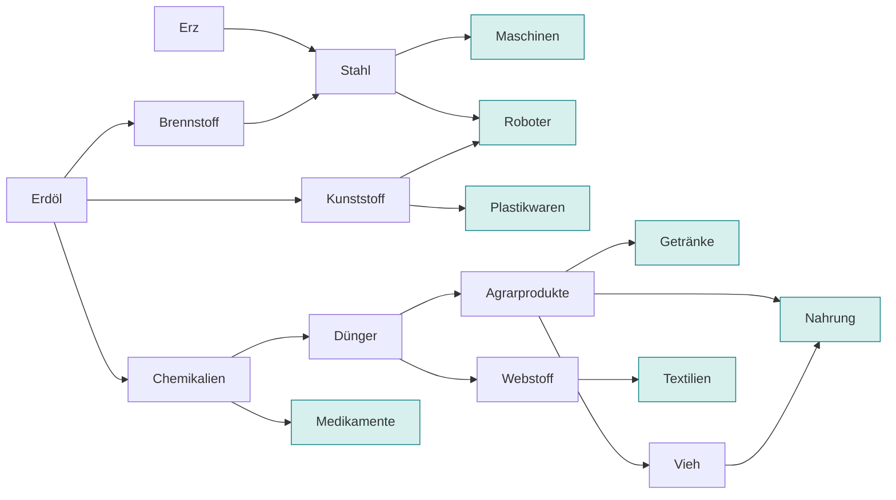

# Dynacorp 2092 – Konzept für ein Android-Fanprojekt nach Dynatech

Stand: 5. November 2026 · Autor: Rocco (poundah-bit)

> Dieses Dokument ist das Spielkonzept, erarbeitet im Chat und hierher übernommen. Die verbindlichen Zahlen stehen in `src/data/*.json`; wo Konzept und Daten abweichen, gelten die Daten. Was sich bei der Umsetzung von Phase 0 zusätzlich ergeben hat, steht im letzten Abschnitt „Entscheidungen aus der Umsetzung“.

## Ziel und Rahmen

Ziel ist eine kostenlose, werbefreie Neuinterpretation des Echtzeit-Wirtschaftsspiels Dynatech (1992) für Android-Tablets und -Smartphones. Übernommen wird das Spielprinzip – Produktionsketten, öffentliche Auftragsbörse, Wettlauf um Aufträge in Echtzeit –, nicht aber Code, Grafik, Musik, Texte oder der Name des Originals.

- **Plattform:** Android (Tablet zuerst, dann Smartphone), technisch als PWA mit optionalem APK – derselbe Stack wie bei Scorched Earth Revival.
- **Modus:** Einzelspieler gegen 20 KI-Firmen. Kein geteilter Bildschirm; ein Online-Mehrspielermodus bleibt eine spätere Option.
- **Lizenz:** Open Source auf GitHub, keine Einnahmen, keine In-App-Käufe.
- **Name:** „Dynacorp 2092“ – 2092 liegt genau 100 Jahre nach dem Erscheinen von Dynatech (1992). Das Original wird nur im Hinweis „inspiriert von Dynatech (1992)“ genannt.

## Das Original

Dynatech erschien 1992 bei [Magic Bytes](https://de.wikipedia.org/wiki/Magic_Bytes), entwickelt von eleven Software, für Amiga (OCS/ECS, AGA) und DOS, nur auf Deutsch. Handbuch und Musik stammen von Holger Gehrmann aus dem früheren reLINE-Team (Oil Imperium, Fate).

- **Setting:** Die Erde ist ausgebeutet; der Konzern DYNATECH liefert Anlagen und Schiffe für die Kolonisierung fremder Planeten. Der Spieler ist Unternehmer, der damit Geld verdient.
- **Kern:** 21 Firmen bilden einen geschlossenen Wirtschaftskreislauf, nur Terra (die Erde) kauft Endprodukte. Kein Kampf, keine Piraterie, keine Sabotage – Zusammenarbeit ist nötig.
- **Echtzeit statt Runden:** Zwei Menschen spielen gleichzeitig auf je einer Bildschirmhälfte, ohne Nachladen.
- **Rezeption:** Amiga Games 11/92 gab 77 %, MobyGames mittelt 68 %. Spieler loben den Zwei-Spieler-Modus, kritisieren die steile Einarbeitung, Menü-Tiefe, den schwachen Solomodus und Leerlauf im Spätspiel.
- **2022:** Eine inoffizielle „30th Anniversary Edition“ übersetzte das Spiel ins Englische und überarbeitete Grafik und Oberfläche.

Diese Kritikpunkte sind der Maßstab für die Modernisierungen weiter unten.

## Waren und Produktionsketten

Alle 18 Waren gehen auf drei Rohstoffe zurück: Erdöl, Wasser und Erz. Jede Ware hat eine von fünf Frachtarten, und jedes Schiff transportiert genau eine Frachtart – das ist der zentrale Engpass des Spiels.

Wasser fließt zusätzlich in Dünger, Medikamente, Agrarprodukte, Webstoff (Plantage), Vieh und Getränke. Hervorgehoben: was Terra kauft.

Nicht eingezeichnet: Webstoff fällt zusätzlich als Nebenprodukt in Zuchtfarm und Kunststoffwerk an.

| Ware | Stufe | Frachtart | Hergestellt in | Aus |
| --- | --- | --- | --- | --- |
| Erdöl | Rohstoff | Tankgut | Ölförderanlage | – |
| Wasser | Rohstoff | Tankgut | Wasserstation | – |
| Erz | Rohstoff | Schüttgut | Erzbergwerk | – |
| Brennstoff | Zwischenprodukt | Tankgut | Raffinerie | Erdöl |
| Chemikalien | Zwischenprodukt | Tankgut | Raffinerie | Erdöl |
| Kunststoff | Zwischenprodukt | Stückgut | Kunststoffwerk | Erdöl |
| Dünger | Zwischenprodukt | Schüttgut | Chemiewerk | Chemikalien + Wasser |
| Stahl | Zwischenprodukt | Stückgut | Stahlwerk | Erz + Brennstoff |
| Agrarprodukte | Rohstoff (Stufe 1) | Kühlfracht | Agro-Betrieb | Dünger + Wasser |
| Webstoff | Rohstoff (Stufe 1) | Schüttgut | Plantage; Nebenprodukt von Zuchtfarm und Kunststoffwerk | Dünger + Wasser |
| Vieh | Rohstoff (Stufe 1) | Lebendfracht | Zuchtfarm | Agrarprodukte + Wasser |
| Getränke | Zwischenprodukt | Stückgut | Getränkefabrik | Agrarprodukte + Wasser |
| Maschinen | Endprodukt | Stückgut | Maschinenfabrik | Stahl |
| Roboter | Endprodukt | Stückgut | Roboterwerk | Stahl + Kunststoff |
| Medikamente | Endprodukt | Stückgut | Pharmawerk | Chemikalien + Wasser |
| Nahrung | Endprodukt | Kühlfracht | Nahrungswerk | Agrarprodukte + Vieh |
| Textilien | Endprodukt | Stückgut | Textilfabrik | Webstoff |
| Plastikwaren | Endprodukt | Stückgut | Fabrik | Kunststoff |

Roh- und Zwischenprodukte werden von Firmen zur Weiterverarbeitung nachgefragt, Endprodukte nur von Terra. Das Handbuch hat einige Druckfehler (Wasserstation „liefert Erdöl“, Nahrungswerk „liefert Webstoff“); die Tabelle nimmt die logisch richtige Lesart. Medikamente gelten unter Spielern als lukrativste Ware im Spätspiel.

## Niederlassungen und Lager

Die 17 Anlagen werden bei DYNATECH auf Terra gekauft und müssen dann als Stückgut zu einem Planeten geflogen werden. Das macht den Stückgutfrachter zum ersten Pflichtkauf.

| Anlage | Preis (Credits) | Wartung (Cr/Tag) | Betrieb (Cr/Tag) | Transportumfang (FE) |
| --- | --- | --- | --- | --- |
| Ölförderanlage | 250.000 | 30 | 100 | 8.000 |
| Wasserstation | 300.000 | 30 | 120 | 10.000 |
| Erzbergwerk | 300.000 | 30 | 100 | 15.000 |
| Raffinerie | 450.000 | 20 | 200 | 15.000 |
| Kunststoffwerk | 420.000 | 20 | 140 | 15.000 |
| Chemiewerk | 400.000 | 20 | 120 | 20.000 |
| Stahlwerk | 450.000 | 20 | 280 | 20.000 |
| Agro-Betrieb | 250.000 | 30 | 250 | 7.000 |
| Plantage | 280.000 | 10 | 100 | 6.000 |
| Zuchtfarm | 300.000 | 10 | 100 | 15.000 |
| Getränkefabrik | 650.000 | 10 | 120 | 50.000 |
| Nahrungswerk | 550.000 | 10 | 500 | 25.000 |
| Textilfabrik | 500.000 | 10 | 160 | 30.000 |
| Fabrik (Plastikwaren) | 750.000 | 30 | 250 | 35.000 |
| Maschinenfabrik | 500.000 | 20 | 290 | 40.000 |
| Roboterwerk | 900.000 | 30 | 400 | 40.000 |
| Pharmawerk | 950.000 | 10 | 120 | 30.000 |

**Regeln aus dem Handbuch**

1. Jeder Planet erlaubt nur eine bestimmte Anlagenart. Eine Anlage wächst, indem man eine gleiche Anlage zum selben Planeten bringt; das zählt weiter als eine Niederlassung.
2. Höchstens 10 Niederlassungen pro Firma.
3. Lebenszyklus: Ankunft → automatischer Bau (Hammer-Symbol) → fertig, aber stillgelegt (rotes Kreuz, ab jetzt Wartungskosten) → „Betrieb aufnehmen“ (grüner Haken, ab jetzt auch Betriebskosten).
4. Anlagen lassen sich stilllegen (spart Betriebskosten bei schlechten Kursen) oder verschrotten.
5. Der Zustand sinkt mit der Zeit; unter 70 % sollte man ein DYNATECH-Wartungsschiff zur Reparatur beauftragen.
6. Lager (z. B. Tanklager) werden ebenfalls bei DYNATECH gekauft und wie Anlagen transportiert. Beispiel: Eine Ölförderanlage fördert 350 FE pro Tag und hat 30.000 FE Tanklager – das reicht nur knapp.

## Raumschiffe

Es gibt 19 Frachter in fünf Frachtarten und bis zu fünf Größen; je größer, desto langsamer und teurer im Unterhalt. Gekauft, verkauft und repariert wird nur in der Werft auf Terra.

| Schiff | Preis (Credits) | Laderaum (FE) | Tempo (Parsec/Tag) | Wartung (Cr/Tag) | Betrieb (Cr/Tag) |
| --- | --- | --- | --- | --- | --- |
| Tanker A | 210.000 | 16.000 | 65 | 5 | 30 |
| Tanker B | 280.000 | 28.000 | 52 | 7 | 40 |
| Tanker C | 340.000 | 45.000 | 40 | 15 | 70 |
| Tanker D | 500.000 | 65.000 | 35 | 10 | 80 |
| Tanker E | 640.000 | 100.000 | 30 | 25 | 160 |
| Schüttgut A | 220.000 | 14.000 | 70 | 6 | 40 |
| Schüttgut B | 270.000 | 25.000 | 57 | 10 | 80 |
| Schüttgut C | 310.000 | 38.000 | 45 | 15 | 140 |
| Schüttgut D | 440.000 | 55.000 | 40 | 20 | 170 |
| Schüttgut E | 600.000 | 80.000 | 38 | 30 | 230 |
| Stückgut A | 230.000 | 15.000 | 80 | 2 | 50 |
| Stückgut B | 290.000 | 26.000 | 67 | 6 | 150 |
| Stückgut C | 350.000 | 38.000 | 57 | 12 | 110 |
| Stückgut D | 450.000 | 55.000 (Handbuch: 5.500) | 48 | 15 | 150 |
| Stückgut E | 650.000 | 80.000 | 45 | 30 | 210 |
| Viehfrachter A | 280.000 | 25.000 | 95 | 10 | 100 |
| Viehfrachter B | 500.000 | 60.000 | 70 | 20 | 150 |
| Kühlfrachter A | 320.000 | 25.000 | 100 | 30 | 200 |
| Kühlfrachter B | 650.000 | 60.000 | 80 | 30 | 300 |

Der Zustand eines Schiffs in Prozent bremst seine Geschwindigkeit. Unter 30 % ist es nicht mehr einsetzbar und landet in der Schrottpresse. Im Handbuch sind die Stückgutfrachter B–E als „Schüttgut“ falsch beschriftet; Stückgut D hat vermutlich 55.000 FE.

## Auftragssystem, Markt und Kredit

Geld verdient man nicht durch Kaufen und Verkaufen auf einem Markt, sondern über eine öffentliche Auftragsbörse: Wer eine Ware braucht, stellt eine Nachfrage ein; wer sie liefern kann, nimmt sie an; wer sie bewegen will, nimmt den Transportauftrag dazu an.

**Zwei Paare von Auftragsarten**

| Art | Wer erledigt sie | Wann sinnvoll |
| --- | --- | --- |
| Eigen-Warennachfrage | eine andere eigene Niederlassung | eigene Kette, z. B. eigenes Öl in die eigene Raffinerie |
| Warennachfrage (öffentlich) | jede Firma, die sie annimmt | Ware fehlt in der eigenen Kette |
| Eigen-Transport | eigenes Schiff mit passender Frachtart | passendes Schiff ist frei |
| Transport (öffentlich) | jede Firma; Honorar mit + / – einstellbar, Minimum am Warenkurs orientiert | kein passendes Schiff vorhanden |

**Ablauf eines Auftrags**

1. Nachfrage oder Transportauftrag stellen (Ware, Ziel-Niederlassung, Menge in FE).
2. Eine Firma übernimmt ihn in „Aufträge suchen“; übernommene Aufträge sind dort markiert.
3. Der Auftrag wird in „Eigene Schiffe → Auftrag übernehmen“ einem freien Schiff mit passender Frachtart zugewiesen.
4. Das Schiff fliegt zum Lieferwerk, lädt, fliegt zum Ziel; das Honorar wird automatisch gutgeschrieben.

**Zeitlimit:** Jeder Auftrag hat eine Frist, abhängig vom Schwierigkeitsgrad; Nachfragen haben etwas mehr Zeit als Transporte. Wer sie überschreitet, zahlt eine vom Warenwert abhängige Strafe an den Auftraggeber.

**Markt:** Der Preis jeder Ware ergibt sich aus Angebot und Nachfrage. Das Marktanalyse-Institut zeigt Kurs, Tendenz (steigend, gleich, fallend), Gesamtnachfrage und Gesamtproduktion. Überproduktion senkt den Kurs – billiges Material für Weiterverarbeiter.

**Kredit:** In der Bank sind Höhe und Laufzeit einstellbar. Das Handbuch rät, zu Beginn den höchsten Betrag mit der längsten Laufzeit zu nehmen.

**Eine Auftragskarte zeigt:** Ware, Auftraggeber, Menge (FE), Wartezeit in der Liste, Auftragsnummer, Start- und Zielplanet, Entfernung in Parsec, Honorar, Frachtart und Auftragnehmer.

## Steuerung, Menüs und Bildschirm des Originals

Das Original wird ausschließlich über rechteckige Icons bedient, die in Haupt- und Untermenüs verschachtelt sind. Jedes Icon wird angewählt (gelb-oranger Rahmen) und mit Maustaste, Feuerknopf oder Enter ausgelöst; ein Hilfsfenster zeigt seine Funktion als Text.

**Start (LOG IN):** Spielerzahl 1 oder 2, Steuerung je Spieler (Maus, Joystick, Tastatur oder Computer), Schwierigkeit (easy, med, hard, prof), dann pro Mensch eines von 4 Büros und der Firmenname.

**Bildschirm:** 11 Bereiche. Pro Spielerhälfte: Datum und Barkapital, Grafikfenster, Blätterpfeile/Beenden, Icon-Leiste, Text des gewählten Icons. Darunter ein gemeinsamer Nachrichtenticker. Kritische Aktionen fragen mit Ja/Nein nach.

**Tastatur (nur PC), zwei Spieler gleichzeitig**

| Richtung | Spieler 1 | Spieler 2 |
| --- | --- | --- |
| hoch / runter | E / C | 8 / 2 |
| links / rechts | S / F | 4 / 6 |
| schräg | W, R, X, V | 7, 9, 1, 3 |
| auswählen | D | Enter |

**Status-Symbole:** Schiff frei (grünes Kreuz), unterwegs (roter Haken), in Reparatur (Hammer). Anlage im Bau (Hammer), fertig aber stillgelegt (rotes Kreuz), in Betrieb (grüner Haken). Schiffe beladen (Doppelpfeil) oder unterwegs (Uhr mit Resttagen).

**Weitere Funktionen:** 10 Speicherplätze, Pause, Bestenliste.

## Ereignisse, Schwierigkeit und Firmenindex

Das Original hat kein festes Spielziel: Gemessen wird am Firmenindex, der Rangliste und Bestenliste speist.

- **Firmenindex** aus Bargeld, Investitionsvolumen (Anlagen, Schiffe), Bilanz (Rentabilität), Ruf (wie schnell Aufträge erledigt werden) und Zusammenarbeit mit anderen Firmen.
- **Schwierigkeit** (4 Stufen) beeinflusst Reaktionstempo der KI, Dauer eines Spieltags, Fristen, Firmenindex und den Highscore-Multiplikator.
- **Wirtschaftskrise:** Arbeiten die Firmen ineffizient und fallen die Kurse, ohne dass Reserven bleiben, endet das Spiel mit „Die Wirtschaft ist zusammengebrochen“.
- **Gravo-Stürme** beschädigen Schiffe und Anlagen; gemeldet über den Ticker.
- **KI-Firmen** werden zu Spielbeginn zufällig aus einer größeren Liste gezogen und haben Vorlieben (etwa Öl oder Landwirtschaft).
- **Ticker-Priorität** steigt automatisch, damit wichtige Meldungen lesbar bleiben.

**Neu gestaltet statt rekonstruiert:** Planeten, Kreditkonditionen und Lager entwirft das Fanprojekt frei, nur am Original orientiert (eigener Abschnitt unten). Für die folgenden Punkte stehen seit Phase 0 erste Schätzwerte in `src/data/`; endgültig festgelegt werden sie im Balancing (Phase 2):

- [ ] Produktionsmengen pro Anlage (Original: Ölförderanlage 350 FE/Tag) und Verbrauchsverhältnisse
- [ ] Basiskurse der 18 Waren und die Preisformel
- [ ] Fristlängen und Strafhöhe je Schwierigkeitsgrad
- [ ] Auslöser und Menge der Terra-Nachfrage

## Planeten, Kredit und Lager – Neuentwurf

Diese Werte sind frei entworfen und orientieren sich nur am Original: 21 Welten, eine Anlagenart pro Kolonie, Entfernungen in Parsec in der Größenordnung des Handbuchs (Terra–Arkan 409 Parsec). Alle Zahlen sind Startwerte für das Balancing und liegen später als JSON vor.

### Planeten

Terra ist das Zentrum: Werft, Bank, DYNATECH und einziger Abnehmer für Endprodukte. Rohstoff-Kolonien liegen nah an Terra, damit der Einstieg mit kleinen Frachtern klappt; Endprodukt-Werke liegen am Rand, damit sich große, schnelle Schiffe erst später lohnen. Öl, Wasser und Erz gibt es je zweimal, damit mehrere Firmen sie fördern können.

Die Koordinaten stehen in `src/data/planets.json`; Entfernungen sind die Luftlinie zwischen ihnen.

| Planet | Anlagenart | X | Y | Entfernung zu Terra (Parsec) | Flugzeit bei 80 Pc/Tag | Flugzeit bei 40 Pc/Tag |
| --- | --- | --- | --- | --- | --- | --- |
| Terra | Werft, Bank, DYNATECH | 0 | 0 | 0 | – | – |
| Vesta Nova | Ölförderanlage | 180 | −120 | 216 | 2,7 Tage | 5,4 Tage |
| Aquilon | Wasserstation | 150 | 190 | 242 | 3,0 Tage | 6,1 Tage |
| Ferrox | Erzbergwerk | −120 | −260 | 286 | 3,6 Tage | 7,2 Tage |
| Halcyon | Chemiewerk | 40 | 330 | 332 | 4,2 Tage | 8,3 Tage |
| Kharon | Ölförderanlage | −260 | 210 | 334 | 4,2 Tage | 8,4 Tage |
| Tethys Prime | Wasserstation | −330 | −140 | 358 | 4,5 Tage | 9,0 Tage |
| Sulcis | Kunststoffwerk | −380 | 40 | 382 | 4,8 Tage | 9,6 Tage |
| Pyros | Raffinerie | 260 | −300 | 397 | 5,0 Tage | 9,9 Tage |
| Vulkan Rho | Stahlwerk | −60 | −420 | 424 | 5,3 Tage | 10,6 Tage |
| Liora | Plantage | −200 | 400 | 447 | 5,6 Tage | 11,2 Tage |
| Magnar | Erzbergwerk | 420 | 160 | 449 | 5,6 Tage | 11,2 Tage |
| Polymer IX | Fabrik (Plastikwaren) | −250 | −380 | 455 | 5,7 Tage | 11,4 Tage |
| Ceres Minor | Agro-Betrieb | 320 | 340 | 467 | 5,8 Tage | 11,7 Tage |
| Mirabel | Zuchtfarm | 480 | −80 | 487 | 6,1 Tage | 12,2 Tage |
| Arkadia | Nahrungswerk | −480 | 300 | 566 | 7,1 Tage | 14,2 Tage |
| Kolossos | Maschinenfabrik | 380 | −420 | 566 | 7,1 Tage | 14,2 Tage |
| Seidra | Textilfabrik | −520 | −260 | 581 | 7,3 Tage | 14,5 Tage |
| Asklepios | Pharmawerk | −600 | 80 | 605 | 7,6 Tage | 15,1 Tage |
| Ostara | Getränkefabrik | 560 | 260 | 617 | 7,7 Tage | 15,4 Tage |
| Automa | Roboterwerk | 620 | −300 | 689 | 8,6 Tage | 17,2 Tage |

**Flugzeit** = Luftlinie zwischen den Koordinaten ÷ (Schiffstempo × Zustandsfaktor), plus je 1 Tag Laden und Entladen. Der Zustandsfaktor sinkt linear von 1,0 (100 %) auf 0,6 (30 %). Gravo-Sturmgebiete liegen im äußeren Ring jenseits von 550 Parsec – dort lohnt sich mehr, dort geht auch mehr kaputt.

### Kredit

| Regel | Startwert |
| --- | --- |
| Startkapital | 250.000 Credits |
| Kreditrahmen | 1.000.000 Credits zu Spielbeginn, danach 50 % des Firmenwerts, höchstens 5.000.000 |
| Laufzeit und Zins | 100 Tage: 4 % · 200 Tage: 5 % · 300 Tage: 6 % (Zins auf die ganze Laufzeit) |
| Tilgung | tägliche Rate = (Betrag + Zins) ÷ Laufzeit; Sondertilgung jederzeit ohne Gebühr |
| Gleichzeitige Kredite | höchstens 2 |
| Zahlungsverzug | Tag 1: +2 % Strafzins auf den Rest · ab Tag 3: Pfändung des günstigsten Schiffs oder Lagers · Barkapital unter −500.000: Konkurs |
| Schwierigkeit | easy −1 Prozentpunkt · med ±0 · hard +1 · prof +2 und Rahmen nur 750.000 |

Beispiel: 1.000.000 Credits über 200 Tage kosten 5.250 Credits pro Tag. Das setzt das Ziel fürs Balancing: Eine einzelne Ölförderanlage mit 350 FE/Tag muss bei Basiskurs rund 15–25 Credits pro FE erlösen, damit sie die Rate fast allein trägt.

### Lager

Jede Anlage hat ein Grundlager von 30.000 FE pro Ware, die sie braucht oder liefert. Zusatzlager gibt es in fünf Arten passend zu den Frachtarten und je drei Größen. Lager werden wie Anlagen als Stückgut von Terra transportiert; die Größe S passt in jeden Stückgut-A-Frachter.

| Lager | Frachtart | Kapazität S / M / L (FE) | Preis S / M / L (Credits) | Wartung S / M / L (Cr/Tag) | Betrieb S / M / L (Cr/Tag) | Transportumfang S / M / L (FE) |
| --- | --- | --- | --- | --- | --- | --- |
| Tanklager | Tankgut | 20.000 / 50.000 / 100.000 | 65.000 / 145.000 / 255.000 | 5 / 10 / 15 | 10 / 20 / 35 | 4.000 / 9.000 / 16.000 |
| Silo | Schüttgut | 20.000 / 50.000 / 100.000 | 50.000 / 105.000 / 185.000 | 4 / 8 / 12 | 5 / 10 / 18 | 4.000 / 9.000 / 16.000 |
| Hallenlager | Stückgut | 20.000 / 50.000 / 100.000 | 60.000 / 130.000 / 230.000 | 5 / 10 / 15 | 10 / 20 / 35 | 4.000 / 9.000 / 16.000 |
| Kühllager | Kühlfracht | 20.000 / 50.000 / 100.000 | 95.000 / 210.000 / 370.000 | 8 / 15 / 25 | 30 / 60 / 105 | 4.000 / 9.000 / 16.000 |
| Stallung | Lebendfracht | 20.000 / 50.000 / 100.000 | 85.000 / 180.000 / 320.000 | 6 / 12 / 20 | 25 / 50 / 90 | 4.000 / 9.000 / 16.000 |

Kühllager und Stallungen sind bewusst teuer im Betrieb: Nahrung und Vieh sollen schnell fließen statt gelagert zu werden.

### Balancing-Zielwerte

Die Werte oben werden in Headless-Läufen gegen diese Ziele geprüft und angepasst:

- Eine Rohstoffanlage amortisiert sich in 60–100 Spieltagen, eine Endprodukt-Anlage in 120–180.
- Ein typischer Transport dauert 3–9 Tage; Fristen = doppelte Flugzeit des langsamsten passenden Schiffs + 2 Tage.
- Zu Spielbeginn frisst die Kreditrate höchstens 60 % der Tageseinnahmen.
- Lagerkosten bleiben unter 5 % der Betriebskosten der Anlage, an der sie stehen.
- Kein Planet ist so abgelegen, dass seine Anlage bei normalen Kursen dauerhaft Verlust macht.

## Touch-Steuerung und Oberfläche für Android

Die Icon-Menüs des Originals werden zu sechs Tabs mit Karten und Listen; die wichtigste Aktion – einen Auftrag schneller als die Konkurrenz annehmen – braucht höchstens zwei Taps.

| Original | Android-Umsetzung |
| --- | --- |
| Hauptmenü mit 6 Icons | untere Navigationsleiste: Stadt, Flotte, Anlagen, Börse (Aufträge suchen), Auftrag geben, Statistik |
| Icon anwählen + Hilfstext | Tap führt aus; langes Drücken zeigt die Erklärung |
| Aufträge blättern mit Pfeilen | scrollbare Liste mit Filtern (Frachtart, Ware, „passt zu freiem Schiff“) |
| Spezielle Nachfragen | gespeicherte Filter als Chips |
| Eigene Schiffe → Auftrag übernehmen | Auftragskarte auf ein freies Schiff ziehen, oder „Annehmen + zuweisen“ in einem Tap |
| Transporthonorar mit + / – | Schieberegler mit Mindestwert |
| Grafikfenster | Sternkarte mit Pinch-Zoom: Planeten, Anlagen, fliegende Schiffe, Routen |
| Nachrichtenticker | schmale Leiste oben; Tap öffnet das Protokoll |
| Nachfrage-Fenster Ja/Nein | Bestätigungsdialog nur bei teuren oder unumkehrbaren Aktionen |
| Pause-Icon | Zeitsteuerung oben rechts: Pause, 1×, 2×, 4× |

**Tablet:** Querformat mit Sternkarte links und Listen rechts nebeneinander, so bleibt die Karte beim Arbeiten in der Börse sichtbar.

**Smartphone:** Hochformat; Sternkarte und Listen liegen in eigenen Tabs, alle Funktionen sind dieselben wie auf dem Tablet.

**Benachrichtigung statt Lauern:** Wenn ein neuer Auftrag erscheint, der zu einem freien eigenen Schiff passt, blinkt der Börsen-Tab mit einem Zähler. Das entschärft das Dauer-Aktualisieren aus dem Original, ohne den Wettlauf abzuschaffen.

**Bedienbarkeit:** Tap-Flächen mindestens 48 dp, Zahlen in Tabellen rechtsbündig mit Tausenderpunkt, Statussymbole zusätzlich mit Farbe und Text, Spielstand-Autosave.

## Modernisierungen gegenüber dem Original

Ein „Klassik“-Regelsatz bleibt nah am Original; die folgenden Neuerungen sind einzeln abschaltbar und zielen auf die bekannten Schwächen.

| Schwäche im Original | Neuerung |
| --- | --- |
| Steile Einarbeitung, Handbuch nötig | geführtes Tutorial entlang des Handbuch-Beispiels (Kredit → Ölförderanlage → Stückgutfrachter → erster Transport) |
| Produktionsketten schwer zu durchschauen | interaktiver Ketten-Graph: welche Ware fehlt, wer sie liefert, aktueller Kurs |
| Leerlauf im Spätspiel, nur noch Aufträge abgreifen | Daueraufträge (wiederkehrende Eigen-Nachfrage + Eigen-Transport), Schiffs-Pendelrouten |
| Kein Spielziel | Szenarien mit Zielen (Firmenindex X bis Tag Y, Rang 1, Kredit tilgen), dazu Endlosmodus |
| Schwacher Solomodus | KI-Persönlichkeiten mit klaren Strategien, mehr Ereignisse (Terra-Krisen, Planeten-Boom) |
| Aufträge erwischt nur, wer ständig die Liste aktualisiert | Benachrichtigung bei passenden Aufträgen; die KI reagiert je nach Schwierigkeit verzögert, damit der Wettlauf fair bleibt |
| Mühsames Nachsehen von Zustand und Lager | Warnsymbole auf der Karte, optional automatische Reparatur ab Schwelle |

Keine Neuerung führt Kampf oder Sabotage ein – die Kooperations-Idee des Originals bleibt erhalten.

## Technik und Architektur

Empfehlung: TypeScript als PWA mit Vite, verpackt per Capacitor als APK – derselbe Weg wie bei Scorched Earth Revival. Ein Wirtschaftsspiel ist überwiegend Listen, Tabellen und eine Karte; dafür passt eine DOM-Oberfläche plus Canvas-Sternkarte besser als eine reine Spiele-Engine.

**Grundsatz: Simulation ohne Grafik.** Der Wirtschaftskern läuft als reines TypeScript ohne Bildschirmbezug, in festen Ticks (1 Spieltag = n Ticks), deterministisch über einen Zufalls-Seed. So lässt sich die Balance in Tests über hunderte Spieltage prüfen, bevor eine Oberfläche existiert.

| Baustein | Aufgabe | Umsetzung |
| --- | --- | --- |
| Spieldaten | Waren, Anlagen, Schiffe, Planeten, KI-Firmen | JSON-Dateien, Werte aus dem Handbuch als Ausgangspunkt |
| Sim-Kern | Produktion, Lager, Markt, Aufträge, Flotte, Kredit, Ereignisse, Firmenindex | reines TypeScript, getestet mit Vitest |
| KI | 20 Konkurrenzfirmen mit Vorlieben | dieselben Aktionen wie Spieler, über einen Entscheidungs-Tick |
| Spielstand | Speichern, Autosave, 10 Slots | IndexedDB, Zustand als JSON |
| Oberfläche | Tabs, Listen, Dialoge | leichtes UI-Framework (z. B. Preact) oder Vanilla-DOM |
| Sternkarte | Planeten, Routen, Schiffe | Canvas 2D (oder Phaser, falls Animationen wachsen) |
| Eingabe | Touch-Gesten: Tap, langes Drücken, Ziehen, Pinch | Pointer Events |
| Verteilung | Installieren auf Android | PWA über GitHub Pages; APK über Capacitor in GitHub Releases, optional F-Droid |

**Alternative:** Godot 4 mit Android-Export, wenn nativer Build und Engine-Werkzeuge wichtiger sind als Wiederverwendung des Scorched-Earth-Stacks. Für ein menülastiges Spiel ist der Vorteil gering.

## Ähnliche Projekte auf GitHub

Ein Dynatech-Remake oder -Klon gibt es auf GitHub nicht – die Suche liefert nur gleichnamige Firmen und Geräte. Die folgenden Projekte taugen als Vorlage für einzelne Teile.

| Projekt | Was es ist | Technik / Lizenz | Nutzen für das Fanprojekt |
| --- | --- | --- | --- |
| [skyshift](https://github.com/rudidev08/skyshift) | selbstlaufende 2D-Weltraumwirtschaft: Stationen produzieren und verbrauchen, Schiffe beliefern nach Mangel | TypeScript, Vite, Phaser 4 / MIT | Vorbild für den grafiklosen Wirtschaftskern, Headless-Balance-Tests und den Produktionsketten-Graphen |
| [stellar-reach](https://github.com/ScottyVenable/stellar-reach) | Sci-Fi-Handels- und Management-Sim für Mobilgeräte | TypeScript, React, Vite; PWA, Desktop und Android-APK aus einer Codebasis / Lizenz nicht angegeben | Vorlage für Verpackung als PWA + APK und deterministische Seeds; Code ohne Lizenz nicht übernehmen |
| [Space Trader (Android)](https://f-droid.org/de/packages/com.brucelet.spacetrader) | Android-Port des Palm-OS-Klassikers | Java / GPL-3.0, auf F-Droid | zeigt, wie ein menülastiges Handelsspiel auf kleinen Bildschirmen funktioniert |
| [space-tycoon](https://github.com/gdg-garage/space-tycoon) | Weltraum-Handels- und Aufbauspiel für KI-Spieler über REST-API | JavaScript / MIT | Idee: KI-Firmen über dieselbe Aktions-Schnittstelle wie Menschen |
| [spaceprojectsim](https://github.com/Kalcode/spaceprojectsim) | Hunderte autonome Schiffe handeln, fördern und transportieren | k. A. | Agentenbasierte KI-Ideen für die 20 Konkurrenzfirmen |
| [Capital and Cargo](https://github.com/dhorions/Capital-and-Cargo) | Handels- und Tycoon-Spiel mit freischaltbaren Funktionen | Unlicense | gemeinfreier Code, frei nutzbar; Idee für schrittweises Freischalten im Tutorial |
| [OpenPatrician](https://sourceforge.net/p/openpatrician/code) | freier Nachbau von Patrizier 1 und 2, Echtzeit-Handel | Java / Open Source (SourceForge, nicht GitHub) | Beispiel für ein jahrelang gepflegtes Wirtschafts-Remake eines deutschen Klassikers |
| [Simutrans](https://www.linuxlinks.com/simutrans/) | Transportsimulation mit verketteten Industrien | C++ / Artistic License | Referenz für die Balance von Lieferketten |

## Rechtliches

Kurz: Spielprinzip nachbauen ja, Original-Material nein – und am besten den Rechteinhaber fragen. Das ist keine Rechtsberatung.

- **Rechteinhaber existiert:** Magic Bytes (heute Bielefeld) ist seit 2017 wieder als Entwickler aktiv. Dass reLINE das Spiel früher zum kostenlosen Download freigab, erlaubt kein Remake.
- **Geschützt:** Name und Logo, Programmcode, Grafiken, Musik, Handbuch- und Spieltexte, Firmen- und Planetennamen als Teil des Werks.
- **In der Regel frei:** Spielmechaniken und Regeln als Idee – Produktionsketten, Auftragsbörse, Frachtarten.
- **Werte aus dem Handbuch** als Ausgangspunkt nehmen, aber selbst neu balancieren statt 1:1 zu übernehmen.
- **Nicht mitliefern:** keine ADF-/DOS-Dateien, keine Screenshots oder Musik des Originals im Repo.
- **Eigener Name:** „Dynacorp 2092“, mit dem Zusatz „inspiriert von Dynatech (1992)“; der Zusatz nennt das Original, ohne es als Marke zu verwenden. Geprüft am 4. November 2026: kein Spiel, keine App und kein Repository mit diesem Namen; die einzige US-Marke „DYNACORP“ (Maschinenbau) ist seit 2022 gelöscht. Vor einer Play-Store-Veröffentlichung noch beim DPMA und EUIPO nachsehen.
- **Nichtkommerziell absichern:** Open-Source-Lizenz (z. B. GPL-3.0 oder MIT), keine Werbung, keine Spenden-Buttons im Spiel.

* [ ] Magic Bytes per E-Mail um Erlaubnis für ein nichtkommerzielles Fanprojekt bitten; eine Zusage würde sogar den Originalnamen ermöglichen

## Roadmap

Die Reihenfolge folgt dem Architektur-Grundsatz: Erst muss die Wirtschaft ohne Grafik stabil laufen, dann kommt die Oberfläche, zuletzt die Veröffentlichung.

| Phase | Inhalt | Tor zum Abschluss | Status |
| --- | --- | --- | --- |
| 0 · Spieldaten und Wirtschaftskern | Waren, Anlagen, Schiffe, Planeten, Lager, Kredit als JSON; Produktion, Markt, Auftragsbörse; headless mit Tests | 200 Spieltage im Test ohne Wirtschaftskollaps | ✅ fertig |
| 1 · Spielbarer Prototyp | Ein Spieler gegen 3 KI-Firmen; Kredit, Anlagenkauf, Börse, Eigen- und Fremdtransport; schlichte Listen-Oberfläche, auf dem Tablet getestet | Handbuch-Beispiel (Kredit, Ölanlage, Frachter, erster Auftrag) durchspielbar | ✅ gebaut, im Browser in Tablet-Größe durchgespielt; Test auf echtem Tablet offen |
| 2 · Volle Wirtschaft und Balancing | 20 KI-Firmen, alle 17 Anlagen und 19 Schiffe, 21 Welten, Terra-Nachfrage; Firmenindex, Gravo-Stürme, Wirtschaftskrise; Werte gegen die Zielwerte justiert | KI-Firmen halten die Wirtschaft im Endlosspiel stabil | offen |
| 3 · Touch-Oberfläche | sechs Tabs, Sternkarte, Ketten-Graph, Auftrags-Benachrichtigung, Zeitsteuerung, Tutorial, Autosave, 10 Speicherplätze | Testrunde auf Tablet und Smartphone ohne Handbuch | offen |
| 4 · Veröffentlichung | PWA über GitHub Pages, APK über Capacitor in GitHub Releases, optional F-Droid; danach Szenarien, Daueraufträge, ggf. Online-Mehrspieler | – | offen |

Jede Phase endet mit einem prüfbaren Tor; Phase 0 trägt das größte Risiko, weil die offenen Punkte zur Balance dort geklärt werden müssen.

## Quellen

- [Dynatech-Handbuch (PDF, deutsch)](https://www.mogelpower.de/manuals/Dynatech_Handbuch.pdf) – Hauptquelle für alle Regeln und Werte
- [MobyGames: Dynatech](https://www.mobygames.com/game/33262/dynatech/) und [MobyRank-Testauszüge](https://www.mobygames.com/game/dynatech/mobyrank)
- [Kultboy: Amiga-Games-Test 11/92 mit Spielerkommentaren](https://www.kultboy.com/index.php?site=t&id=18) und [Testübersicht](https://www.kultboy.com/testbericht-uebersicht/13/)
- [amiga-news.de: 30th Anniversary Edition](https://amiga-news.de/en/news/AN-2022-09-00078-EN.html) · [Projektseite](https://sketchy.work/dynatech/)
- [MogelPower: Tipps zu Dynatech](https://www.mogelpower.de/cheats/Dynatech_PC_41470.html)
- [Squakenet: Spielbeschreibung](https://www.squakenet.com/game/dynatech/)
- [Wikipedia: Magic Bytes](https://wikipedia.jakami.de/content/wikipedia_de_all_mini_2024-06/A/Magic_Bytes)
- [vollversion.de: Freigabe durch reLINE](https://www.vollversion.de/programm/dynatech.html)
- GitHub- und Projektseiten: siehe Tabelle „Ähnliche Projekte“

## Entscheidungen aus der Umsetzung (Phase 0)

Bei der Umsetzung des Wirtschaftskerns kamen diese Festlegungen hinzu. Sie stehen so im Code und in den Daten.

| Thema | Entscheidung | Warum |
| --- | --- | --- |
| Name und Repo | „Dynacorp 2092“, Repo `poundah-bit/Dynacorp---2092`, öffentlich, Lizenz MIT | 2092 = 100 Jahre nach Dynatech (1992) |
| Mehrspieler | kein geteilter Bildschirm; Einzelspieler gegen 20 KI-Firmen | auf Tablet und Smartphone nicht sinnvoll |
| Terra als Abnehmer | Terra kauft Endprodukte immer und alle anderen Waren als Grundbedarf | ohne Grundbedarf finden Rohstoffe am Anfang keine Käufer |
| Preis-Stabilisator | je billiger eine Ware unter ihrem Basiskurs, desto häufiger und mehr kauft Terra davon | ohne ihn brach die Wirtschaft in Tests regelmäßig zusammen |
| Schwierigkeitsgrad | Kreditrahmen und Zinsaufschlag gelten nur für den Spieler; KI-Reaktionstempo, Fristen und Strafen für alle | die KI soll auf jeder Stufe eine funktionierende Wirtschaft aufbauen |
| Verschleiß | Anlagen produzieren erst unter 90 % Zustand weniger, minimal 50 % | kleine Abnutzung soll nicht sofort Ertrag kosten |
| Produktionsraten und Basiskurse | erste Schätzwerte in `src/data/facilities.json` und `goods.json` | im Konzept nicht festgelegt |
| Reparatur von Anlagen | vorerst sofort; Anflug des Wartungsschiffs kommt mit der Oberfläche | vereinfacht Phase 0 |
| KI-Kredite | die KI leiht nur, was ein geplanter Kauf braucht, mit der längsten Laufzeit | volle Kreditrahmen ruinierten die KI mit Tagesraten |
| Bekannter Balancing-Stand | nach 300 Tagen wächst die Wirtschaft (≈ 40 Anlagen, keine Bankrotte), Rohstoffanlagen dominieren aber lange | Feintuning ist Aufgabe von Phase 2 |

## Entscheidungen aus der Umsetzung (Phase 1)

| Thema | Entscheidung | Warum |
| --- | --- | --- |
| Tabs | Terra (Bank, DYNATECH, Werft), Anlagen, Flotte, Börse, Aufträge, Statistik; „Ware bestellen“ sitzt an der Anlage statt in einem eigenen Tab „Auftrag geben“ | man bestellt immer für eine bestimmte Anlage |
| Einstiegshilfe | Hinweiskasten „Nächster Schritt“, der sich aus dem Spielstand ergibt, hebt den passenden Knopf hervor; kein festes Skript | übersteht Umwege des Spielers; das geführte Tutorial kommt in Phase 3 |
| Ein Tap statt Menü-Kette | nach dem Anlagenkauf öffnet sich gleich der Transport; „Liefern“ = annehmen + Schiff wählen, kaufen oder öffentlich ausschreiben | wichtigste Aktion in höchstens zwei Taps |
| Zeit | Spiel startet pausiert; 1× = 2 Sekunden pro Spieltag, dazu 2× und 4× | Einsteiger lesen erst, Profis spulen vor |
| Spielstand | ein Autosave-Platz im Browser (localStorage) | 10 Speicherplätze mit IndexedDB folgen in Phase 3 |
| Beobachtungsmodus | die Phase-0-Seite liegt jetzt unter `observe.html` | `index.html` ist das Spiel |
| Ticker | der Kern meldet jetzt auch bezahlte Lieferungen, Honorare und übernommene Aufträge | sonst erfährt der Spieler nicht, dass Geld kam |
| Wirtschaft mit 3 KI-Firmen | bleibt in Tests stabil, ist aber dünn (4–8 Anlagen nach 200 Tagen) | Phase 2 bringt 20 KI-Firmen und das Balancing |
